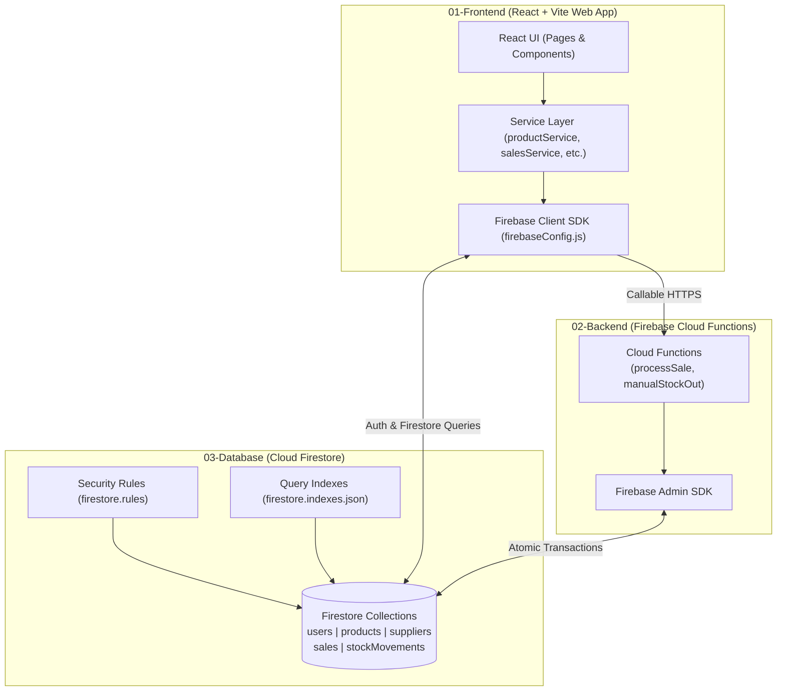

# Smart Inventory and Sales Management System
**University Information System Project — Component-Separated Submission**

---

## 1. Project Overview & Objectives

The **Smart Inventory and Sales Management System** is a full-stack, web-based information system engineered for retail businesses transitioning from error-prone manual spreadsheets to a centralized, role-governed platform.

### Core Objectives:
1. **Accurate Stock Control:** Prevent stockouts and overstocking through automated stock deductions and reorder threshold tracking.
2. **Secure Sales Processing:** Move sensitive checkout logic and pricing calculation to server-side Firebase Cloud Functions to prevent client tampering.
3. **Data Integrity & Traceability:** Maintain an immutable movement ledger (`stockMovements`) recording operator identity, timestamps, and reason codes for all stock receipts, deductions, and write-offs.
4. **Relational Consistency:** Safeguard against orphaned products by blocking supplier deletions when products reference the vendor.
5. **Business Visibility:** Provide real-time financial valuation, weekly sales trend charts, and customizable reports with RFC-4180 CSV export.

To meet university submission standards, the project is structured into **three clearly separated, modular components**:
- **01-Frontend:** React + Vite Single Page Application.
- **02-Backend:** Node.js + TypeScript Firebase Cloud Functions.
- **03-Database:** Cloud Firestore security rules, compound indexes, and sample datasets.
- **04-UI-UX-Design:** Figma design system specifications and vector artboards.



---

## 2. Technology Stack

- **Frontend:**
  - **Framework:** React 18 with Vite 5 bundler
  - **Styling:** Tailwind CSS (responsive desktop-first utility styling)
  - **Routing:** React Router DOM v6 (protected routes with role-based PublicRoute/ProtectedRoute guards)
  - **Visualizations:** Recharts (responsive AreaChart, BarChart, and PieChart components)
  - **Icons:** Lucide React
  - **Client SDK:** Firebase JavaScript SDK v10 (Authentication, Firestore, Callable Functions)
- **Backend:**
  - **Runtime:** Node.js with TypeScript (`tsc`)
  - **Platform:** Firebase Cloud Functions (Callable HTTPS functions)
  - **Admin Integration:** Firebase Admin SDK (privileged server-side Firestore transactions)
- **Database:**
  - **Engine:** Google Cloud Firestore (NoSQL document database)
  - **Security:** Granular Firestore Security Rules (`firestore.rules`)
  - **Indexing:** Compound query indexing (`firestore.indexes.json`)
- **Testing:**
  - Native Node.js ESM automated test suites (93 passing assertions across 4 test phases)

---

## 3. Project Folder Structure

```
Inventory_System/
│
├── 01-Frontend/                    # Component 1: Client Application
│   ├── public/                     # Static assets
│   ├── src/                        # React source code
│   │   ├── components/             # Reusable UI widgets (Navbar, Sidebar, Tables, Forms, StatCard, WarehouseHeroIllustration)
│   │   ├── pages/                  # Views (Landing, Login, Dashboard, Products, Inventory, Sales, Suppliers, Reports)
│   │   ├── layouts/                # DashboardLayout and navigation shell
│   │   ├── services/               # Firestore queries & business logic operations
│   │   │   ├── authService.js      # Session management and role resolution
│   │   │   ├── productService.js   # Product catalog CRUD and duplicate SKU detection
│   │   │   ├── supplierService.js  # Supplier CRUD and deletion safeguard checks
│   │   │   ├── inventoryService.js # Stock-In, Manual Stock-Out, and Movement Ledger
│   │   │   └── salesService.js     # POS checkout and Callable Cloud Function invocation
│   │   ├── firebase/               # firebaseConfig.js (Client SDK initialization & demo fallback)
│   │   ├── hooks/                  # useAuth.jsx (Role verification & session persistence)
│   │   └── utils/                  # Formatters, currency, date (parseDate), and SKU helpers
│   ├── .env                        # Environment variable configuration template
│   ├── index.html                  # HTML5 entry template
│   ├── package.json                # Frontend dependencies
│   ├── vite.config.js              # Vite build & chunking configuration
│   └── README.md                   # Component 1 detailed documentation
│
├── 02-Backend/                     # Component 2: Server Business Logic
│   ├── src/
│   │   └── index.ts                # TypeScript Cloud Functions (processSale, manualStockOut)
│   ├── package.json                # Cloud Functions dependencies
│   ├── tsconfig.json               # TypeScript compiler options
│   ├── test-sales-security.mjs     # Phase 1 backend verification suite (23 tests)
│   └── README.md                   # Component 2 detailed documentation
│
├── 03-Database/                    # Component 3: Persistent Data & Rules
│   ├── firestore.rules             # Role-based access security rules
│   ├── firestore.indexes.json      # Compound query indexes
│   ├── schema/
│   │   └── COLLECTIONS.md          # Entity-Relationship diagram & schema reference
│   ├── sample-data/                # University evaluation datasets (JSON format)
│   │   ├── users.json              # Test user accounts
│   │   ├── products.json           # Catalog items with pricing & thresholds
│   │   ├── suppliers.json          # Trade vendor records
│   │   ├── sales.json              # Historical sale transaction receipts
│   │   └── stockMovements.json     # Immutable movement audit logs
│   ├── scripts/
│   │   ├── package.json            # Seed utility configuration
│   │   └── seedDatabase.js         # Node.js Firestore seed utility
│   └── README.md                   # Component 3 detailed documentation
│
├── 04-UI-UX-Design/                # Component 4: Figma Design System & Specification
│   ├── FIGMA-DESIGN-SPECIFICATION.md# Master design specification & prototype matrix
│   ├── tokens/
│   │   └── figma-tokens.json       # Importable Figma tokens (Colors, Typography, Spacing)
│   ├── vector-artboards/           # 9 editable SVG artboards ready to import into Figma
│   └── README.md                   # Figma assembly and presentation guide
│
├── firebase.json                   # Root Firebase configuration linking all 3 components
├── .gitignore                      # Git ignore rules for all components
├── package.json                    # Root orchestration scripts
├── test-phase2.mjs                 # Phase 2 test suite (Supplier CRUD & SKU uniqueness, 24 tests)
├── test-phase3.mjs                 # Phase 3 test suite (Manual stock-out, charts, reports, 46 tests)
├── test-phase4.mjs                 # Phase 4 integration test suite (Cross-module RBAC & QA, 27 tests)
├── test-auth-persistence.mjs       # Authentication persistence test suite (6 tests)
├── test-landing-browser.mjs        # Landing page & navigation browser verification in Chrome (6 tests)
├── test-responsive.mjs             # Responsive viewport verification across 5 screen sizes (5 tests)
└── PROJECT-README.md               # Master submission documentation (this document)
```

---

## 4. University Requirements Coverage (FR1 – FR10)

| Requirement | Description | Implementing Component | Key Files | Status |
| :--- | :--- | :--- | :--- | :--- |
| **FR1 — User Access** | Role-based authentication (Admin, Inventory Staff, Sales Staff) | `01-Frontend`, `03-Database` | `src/hooks/useAuth.jsx`, `firestore.rules` | **Verified** |
| **FR2 — Product Catalogue** | Create, view, update, deactivate products, and duplicate SKU prevention | `01-Frontend`, `03-Database` | `src/pages/Products.jsx`, `productService.js` | **Verified** |
| **FR3 — Stock Management** | Stock received, manual stock-out write-offs, and count adjustments | `01-Frontend`, `02-Backend` | `src/pages/Inventory.jsx`, `inventoryService.js` | **Verified** |
| **FR4 — Supplier Records** | Supplier CRUD with product association deletion safeguard | `01-Frontend`, `03-Database` | `src/pages/Suppliers.jsx`, `supplierService.js` | **Verified** |
| **FR5 — Sales Transactions** | Multi-item POS counter checkout with receipt modal | `01-Frontend`, `02-Backend` | `src/pages/Sales.jsx`, `salesService.js` | **Verified** |
| **FR6 — Automatic Stock Update** | Atomic server-side stock decrement with insufficient stock prevention | `02-Backend`, `01-Frontend` | `02-Backend/src/index.ts`, `salesService.js` | **Verified** |
| **FR7 — Low-Stock Alerts** | Automated identification of items at or below reorder level | `01-Frontend` | `Navbar.jsx`, `Dashboard.jsx`, `formatters.js` | **Verified** |
| **FR8 — Transaction History** | Multi-criteria searchable movement audit ledger & sales history | `01-Frontend`, `03-Database` | `Inventory.jsx`, `Sales.jsx`, `firestore.rules` | **Verified** |
| **FR9 — Reports & Dashboard** | Dynamic weekly sales trends, valuation cards, and CSV export | `01-Frontend` | `src/pages/Dashboard.jsx`, `Reports.jsx` | **Verified** |
| **FR10 — Validation & Feedback** | Required field validation, anti-tampering, error & success toasts | `01-Frontend`, `02-Backend` | `ProductForm.jsx`, Toast notifications | **Verified** |

---

## 5. Security & Firestore Rules Architecture

Security is enforced using a **Defense-in-Depth** architecture combining Firestore Rules with server-side Cloud Functions:

1. **Strict Client-Side Mutation Lockdown on Sales:**
   - In `03-Database/firestore.rules`, `match /sales/{saleId}` specifies `allow create, update, delete: if false;`.
   - Direct client writes to the sales collection are strictly rejected. All sales must be processed through the privileged `processSale` Callable Cloud Function.
2. **Protection Against Client-Side Stock Deduction:**
   - In `match /stockMovements/{movementId}`, direct creation of `stock_out` records is prohibited (`request.resource.data.type != 'stock_out'`).
   - `stock_out` movements can only be generated through server-side Cloud Functions (`processSale` and `manualStockOut`), guaranteeing that inventory cannot be written off without server validation.
3. **Product Stock Manipulation Prevention:**
   - Only `Inventory Staff` and `Admin` can update products (`allow create, update: if isInventoryStaff();`). `Sales Staff` has read-only access to products.
4. **Anti-Tampering Pricing:**
   - In `processSale`, item prices supplied by the client are discarded. The backend queries trusted selling prices directly from Firestore documents.

---

## 6. Database Collections & Schema Structure

The Firestore database consists of 5 top-level collections:

### 1. `users`
- `uid`: Unique Auth ID (Document ID)
- `name`: Full user display name (String)
- `email`: Normalized user email (String)
- `role`: Role string (`Admin`, `Inventory Staff`, or `Sales Staff`)
- `createdAt`: Server timestamp

### 2. `products`
- `id`: Unique product ID
- `name`: Product catalog title (String)
- `sku`: Stock Keeping Unit (Unique, uppercase normalized String)
- `category`: Category classification (e.g. `Electronics`, `Supplies`)
- `purchasePrice`: Unit cost price in USD (Number)
- `sellingPrice`: Unit retail selling price in USD (Number)
- `quantity`: Current on-hand stock balance (Integer)
- `reorderLevel`: Minimum replenishment threshold (Integer)
- `supplierId`: Associated vendor ID (FK to `suppliers`)
- `isActive`: Boolean flag indicating catalog availability
- `createdAt`, `updatedAt`: Timestamps

### 3. `suppliers`
- `id`: Unique supplier ID
- `name`: Company / organization name (String)
- `email`: Contact email address (String)
- `phone`: Contact telephone number (String)
- `address`: Physical mailing / warehouse address (String)
- `createdAt`, `updatedAt`: Timestamps

### 4. `sales`
- `id`: Document ID
- `saleId`: Human-readable invoice code (e.g. `INV-596765-102`)
- `items`: Array of objects (`productId`, `name`, `quantity`, `unitPrice`, `subtotal`)
- `totalAmount`: Trusted calculated total in USD (Number)
- `paymentMethod`: `Cash`, `Credit Card`, or `Mobile Pay`
- `customerName`: Buyer name (default: `Walk-in Customer`)
- `soldBy`: Cashier operator identity
- `status`: `completed`
- `createdAt`: Server timestamp

### 5. `stockMovements` (Immutable Audit Ledger)
- `id`: Auto-generated movement ID
- `productId`: Target product ID
- `productName`: Product name snapshot
- `type`: Movement classification (`stock_in`, `stock_out`, `adjustment`)
- `quantity`: Signed or unsigned quantity delta
- `previousQuantity`: Balance prior to operation
- `newQuantity`: Balance after operation
- `referenceId`: Audit reference (e.g. `PO-RESTOCK`, `SO-DAMAGED-01`, `INV-102`)
- `notes`: Reason or transaction notes
- `userId`: Verified operator identity
- `createdAt`: Server timestamp

---

## 7. Dual-Mode Architecture: Offline Demo Mode vs. Live Firebase

The system incorporates a **dual-mode engine** designed to facilitate university evaluation:

| Mode | Trigger Condition | Data Persistence | Backend Logic | Status Indicator |
| :--- | :--- | :--- | :--- | :--- |
| **Simulated Demo Mode** | Default when no live API keys configured | Browser `localStorage` with preloaded academic datasets | Client-side transactional simulation matching Cloud Function rules | Amber badge in Navbar: `Simulated Demo Mode` |
| **Cloud Firestore Live** | Valid `VITE_FIREBASE_API_KEY` provided in `.env` | Cloud Firestore database | Callable Firebase Cloud Functions executed via Google Cloud | Emerald badge in Navbar: `Cloud Firestore Live` |

Both modes enforce identical validation, inventory deductions, reference checks, and role restrictions.

---

## 8. Supervisor Quick Evaluation Accounts

The system includes instant 1-click test credentials on the Login screen and a **Supervisor Role Switcher** widget in the Sidebar:

| Role | Test Account Name | Email | Password | Access Scope |
| :--- | :--- | :--- | :--- | :--- |
| **Admin** | Sarah Connor | `admin@inventory.edu` | `demo123` | Full access across all modules |
| **Inventory Staff** | Michael Chen | `inventory@inventory.edu` | `demo123` | Product catalog, stock-in, manual stock-out, adjustments, suppliers |
| **Sales Staff** | Amina Patel | `sales@inventory.edu` | `demo123` | Point of Sale (POS) counter, customer sales history |

---

## 9. How to Setup and Run the Application

### Prerequisites:
- Node.js 18+ or 20+ installed
- npm 9+

### A. Root Quick Start:
```bash
# Install root dependencies
npm install

# Start Frontend Development Server
npm run dev:frontend
# -> Opens http://localhost:5173

# Build Frontend for Production
npm run build:frontend

# Build Backend Cloud Functions
npm run build:backend

# Run All Verification Test Suites
npm run test:all
```

### B. Component-Specific Commands:
```bash
# 1. Frontend
cd 01-Frontend
npm install
npm run dev      # Local Vite server
npm run build    # Production build

# 2. Backend
cd 02-Backend
npm install
npm run build    # Compiles TypeScript src/ to lib/
npm test         # Runs Phase 1 backend security tests

# 3. Database
cd 03-Database/scripts
node seedDatabase.js # Populates Firestore with evaluation sample data
```

---

## 10. Automated Testing Guide

The project includes comprehensive automated test suites running without third-party test runners:

```bash
# Run all core test suites sequentially
npm run test:all

# Run browser and responsive verification suites
npm run test:landing
npm run test:responsive
```

Individual test suites:
- `npm run test:backend`: Verifies `processSale` Cloud Function (23 tests: auth, roles, negative/float quantities, out of stock, trusted price calculation, atomic deduction).
- `npm run test:phase2`: Verifies Supplier CRUD, deletion safeguard, and duplicate SKU prevention (24 tests).
- `npm run test:phase3`: Verifies `manualStockOut`, dynamic weekly sales trend, reports filtering, and CSV export (46 tests).
- `npm run test:phase4`: Verifies cross-module RBAC, immediate reference checking, and `parseDate` normalization (27 tests).
- `npm run test:auth`: Verifies offline account registration, session logout, and persistent credential verification (6 tests).
- `npm run test:landing`: Verifies public landing page elements and navigation routing in real headless Google Chrome (6 tests).
- `npm run test:responsive`: Verifies responsive layout rendering across 5 target viewports: 1440px, 1280px, 768px, 375px, and 390px (5 tests).

**Total Verified Assertions: 137 passing, 0 failing across all 7 test suites.**

---

## 11. Known Technical Limitations & Concurrency Notes

1. **Application-Level SKU Uniqueness:**
   - In this academic system, SKU uniqueness is validated at the service and UI form layer (`isSkuDuplicate`).
   - For an enterprise system with high concurrency, race conditions could theoretically occur if two cashiers create the same SKU at the identical millisecond. In an enterprise system, this would be enforced via a dedicated `/skus/{normalizedSku}` Firestore unique index collection.
2. **Localhost CLI Emulator on Node.js v26:**
   - The global `firebase-tools` CLI crashes under Node.js v26 due to an upstream dependency issue (`buffer-equal-constant-time` accessing `SlowBuffer.prototype`). For live emulator usage, Node.js v20 LTS is recommended.
3. **Offline Demo Mode Scope:**
   - When running in offline demo mode, data is persisted to browser `localStorage`. Clearing browser site data resets the database to the initial evaluation dataset.

---

## 12. University Submission Deliverable

To produce the final ZIP file for university submission:
1. Ensure both frontend and backend are compiled: `npm run build:all`.
2. Delete `node_modules` folders if a lightweight source archive is requested (or preserve if an offline bundle is required).
3. The root folder contains `01-Frontend`, `02-Backend`, `03-Database`, `04-UI-UX-Design`, and master documentation ready for immediate supervisor inspection.
