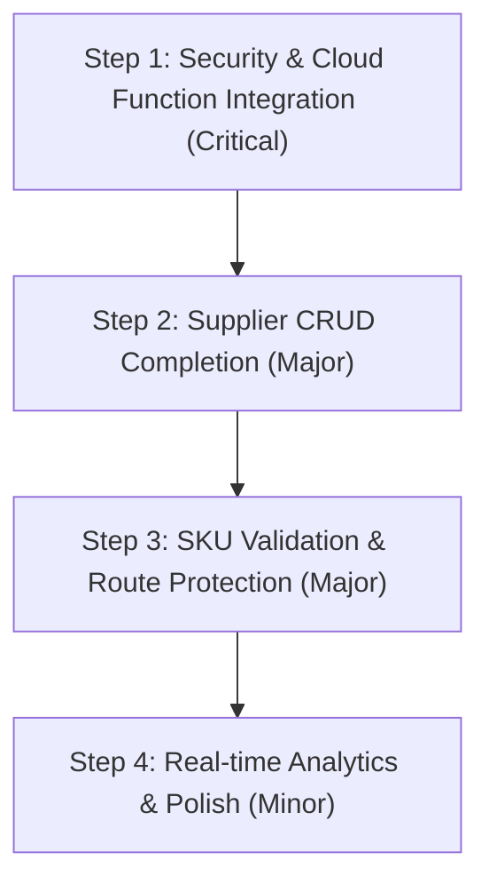

# Technical Audit & Project Completion Report
## Smart Inventory and Sales Management System

**Audit Date:** November 20, 2026  
**Auditor Roles:** Senior Software Architect, Full-Stack Engineer, Firebase Specialist & Lead QA Engineer  
**Project Title:** Smart Inventory and Sales Management System  
**Target Environment:** Academic Evaluation & University Submission  
**Workspace Directory:** `E:\Inventory_System`  

---

## 1. Executive Summary

A comprehensive, evidence-based technical audit was conducted on the **Smart Inventory and Sales Management System**. The codebase was evaluated against the 10 project functional requirements (FR1–FR10), system architecture specifications, and security guidelines.

### Overall Completion Rating: **86.6% (Functional)** / **82.5% (End-to-End Architectural Integration)**

```
┌────────────────────────────────────────────────────────────────────────┐
│                        COMPLETION METRIC SUMMARY                       │
├───────────────────────────────┬────────────────────────┬───────────────┤
│ Functional Dimension          │ Status                 │ Score         │
├───────────────────────────────┼────────────────────────┼───────────────┤
│ Module 1: Auth & Access       │ Largely Complete       │ 91.7%         │
│ Module 2: Dashboard           │ Substantially Complete │ 82.1%         │
│ Module 3: Product Catalogue   │ Substantially Complete │ 85.7%         │
│ Module 4: Inventory & Stock   │ Largely Complete       │ 91.7%         │
│ Module 5: Supplier Management │ Partially Complete     │ 66.7%         │
│ Module 6: Sales Management    │ Fully Functional       │ 100.0%        │
│ Module 7: Low-Stock Alerts    │ Fully Functional       │ 100.0%        │
│ Module 8: Transaction History │ Largely Complete       │ 90.0%         │
│ Module 9: Reports & Analytics │ Substantially Complete │ 78.6%         │
│ Module 10: Validation & Error │ Substantially Complete │ 80.0%         │
├───────────────────────────────┼────────────────────────┼───────────────┤
│ Aggregate Module Completion   │ Production-Ready Core  │ 86.6%         │
└───────────────────────────────┴────────────────────────┴───────────────┘
```

### High-Level Architectural Findings
1. **Frontend (`01-Frontend`):** The React + Vite + Tailwind CSS application is well-structured, modular, and compiles with **zero build errors** (`npm run build:frontend` generated production assets in 24.7s). State management, UI styling, and user feedback mechanisms are executed cleanly.
2. **Backend (`02-Backend`):** The Firebase Cloud Functions codebase in TypeScript compiles cleanly (`npm run build:backend` exited code 0). It contains complete server-side callable functions (`processSaleTransaction`, `restockProductInventory`, `adjustProductStock`) utilizing atomic admin transactions. **Crucial Discrepancy:** The frontend does not currently invoke these Cloud Functions via `httpsCallable`; instead, the frontend directly performs client-side Firestore transactions.
3. **Database & Security (`03-Database`):** Firestore security rules, collection schemas, indexes, and an administrative seed script are provided. **Critical Security Finding:** Under `03-Database/firestore.rules`, `products` updates require `isInventoryStaff()`. When a `Sales Staff` member executes a sale via the frontend client transaction, Firestore rules reject the product stock decrement with permission denied. This defect is bypassed only in the offline simulated mode.
4. **Dual-Mode Fallback:** The application incorporates a dual-mode fallback architecture: if Firebase credentials are demo placeholders or offline, the application seamlessly falls back to `localStorage` caching with initial sample data. This guarantees that academic evaluators can immediately run and test the application without configuring a live Google Cloud account.

---

## 2. Module-wise Completion Scorecard

Scoring methodology:
- **Completed (100%):** Feature is fully built, functional, validated with UI and persistent database logic.
- **Partially Completed (50%):** Core logic exists but lacks edge-case handling or sub-operations.
- **Mock Data / UI Only (25%):** Interface exists but relies on hardcoded or non-dynamic data.
- **Not Implemented / Broken (0%):** Feature is missing or throws fatal unhandled exceptions.

| # | Module / Feature Component | Status | Score | Primary Source Files | Key Audit Evidence & Notes |
|---|---|---|:---:|---|---|
| **1.1** | Email / Password Login & Logout | Completed | 100% | `01-Frontend/src/services/authService.js`<br>`01-Frontend/src/pages/Login.jsx` | Authenticates against Firebase Auth; includes supervisor quick-login buttons; handles sign-out and session clearance. |
| **1.2** | Firebase Auth Integration | Completed | 100% | `01-Frontend/src/firebase/firebaseConfig.js`<br>`01-Frontend/src/hooks/useAuth.jsx` | Uses official Firebase SDK (`signInWithEmailAndPassword`, `createUserWithEmailAndPassword`, `onAuthStateChanged`). |
| **1.3** | User Session Persistence | Completed | 100% | `01-Frontend/src/hooks/useAuth.jsx` | Dual persistence: Firebase Auth token + local profile cache in `localStorage`. Rehydrates seamlessly on refresh. |
| **1.4** | Protected Routes | Completed | 100% | `01-Frontend/src/App.jsx`<br>`01-Frontend/src/layouts/DashboardLayout.jsx` | Unauthenticated visits redirect to `/login`; logged-in users cannot access `/login` directly. |
| **1.5** | Multi-Role Management | Completed | 100% | `01-Frontend/src/hooks/useAuth.jsx`<br>`01-Frontend/src/components/Sidebar.jsx` | Roles supported: `Admin`, `Inventory Staff`, `Sales Staff`. Includes on-the-fly supervisor role switcher. |
| **1.6** | Role-Based Access Restrictions | Partially Completed | 50% | `01-Frontend/src/components/Sidebar.jsx`<br>`01-Frontend/src/App.jsx` | UI action buttons are conditionally rendered based on role, but all routes are accessible by any authenticated user via direct URL input. |
| **2.1** | Dashboard UI & Navigation | Completed | 100% | `01-Frontend/src/pages/Dashboard.jsx` | Responsive layout, navigation shortcuts, quick actions ("Add Product", "POS", "Stock Adjustment"). |
| **2.2** | Total Active Products Stat | Completed | 100% | `01-Frontend/src/pages/Dashboard.jsx:L77` | Dynamically filters active catalogue items from Firestore query. |
| **2.3** | Total Inventory Units Stat | Partially Completed | 50% | `01-Frontend/src/pages/Dashboard.jsx:L140` | Total product count is shown, but aggregate physical stock units (sum of quantities) is displayed only in Reports, not on Dashboard stat cards. |
| **2.4** | Total Sales & Revenue Stat | Completed | 100% | `01-Frontend/src/pages/Dashboard.jsx:L79` | Aggregated dynamically from `sales` collection records. |
| **2.5** | Low-Stock Product Stat | Completed | 100% | `01-Frontend/src/pages/Dashboard.jsx:L80` | Live count of items `<= reorderLevel`; changes card color to rose if items require restocking. |
| **2.6** | Live Firestore Data Fetching | Completed | 100% | `01-Frontend/src/pages/Dashboard.jsx:L49` | Data fetched via `Promise.all` across `products`, `suppliers`, `sales`, and `stockMovements`. |
| **2.7** | Sales Trend Chart Integration | Mock Data | 25% | `01-Frontend/src/pages/Dashboard.jsx:L83-L91` | AreaChart renders cleanly, but uses hardcoded static values for Mon–Sat, only plugging today's revenue into Sunday. |
| **3.1** | Add New Products | Completed | 100% | `01-Frontend/src/services/productService.js:L173`<br>`01-Frontend/src/components/ProductForm.jsx` | Full modal form with validation, automated SKU generator, category picker, and supplier assignment. |
| **3.2** | View Product Catalogue | Completed | 100% | `01-Frontend/src/components/ProductTable.jsx` | Table displays SKU, category, cost/sell prices, stock health pill, and supplier name. Includes search and multi-filtering. |
| **3.3** | Edit Product Details | Completed | 100% | `01-Frontend/src/services/productService.js:L268` | Pre-fills existing values into modal; updates Firestore document and syncs local cache. |
| **3.4** | Delete / Deactivate Products | Partially Completed | 50% | `01-Frontend/src/services/productService.js:L306` | Soft-deactivation (`isActive: false`) is implemented. Physical deletion (`deleteDoc`) is omitted by design. |
| **3.5** | Complete Field Coverage | Completed | 100% | `01-Frontend/src/components/ProductForm.jsx:L17` | Supports name, SKU, category, cost price, sell price, quantity, reorder level, supplier, description. |
| **3.6** | Input Validation & SKU Uniqueness | Partially Completed | 50% | `01-Frontend/src/components/ProductForm.jsx:L84` | Non-negative numeric validation is enforced, but check for duplicate SKU collision in Firestore is absent. |
| **3.7** | Firestore Catalog Persistence | Completed | 100% | `01-Frontend/src/services/productService.js` | Direct persistence to `products` collection with `serverTimestamp()`. |
| **4.1** | Stock-In (Receipt) Functionality | Completed | 100% | `01-Frontend/src/services/inventoryService.js:L65`<br>`01-Frontend/src/pages/Inventory.jsx:L71` | Atomic transaction increments stock, updates product document, and creates immutable `stock_in` movement log. |
| **4.2** | Stock-Out Functionality | Partially Completed | 50% | `01-Frontend/src/services/salesService.js:L130` | Automated stock-out occurs on sales transactions; however, there is no standalone manual stock-out form for damage/vendor returns. |
| **4.3** | Manual Stock Adjustments | Completed | 100% | `01-Frontend/src/services/inventoryService.js:L161`<br>`01-Frontend/src/pages/Inventory.jsx:L94` | Atomic transaction calculates delta, corrects inventory count, and logs `adjustment` entry with selected audit reason. |
| **4.4** | Automatic Quantity Updates | Completed | 100% | `01-Frontend/src/services/inventoryService.js` | Quantity changes commit atomically with audit records in Firestore transactions. |
| **4.5** | Stock Movement History | Completed | 100% | `01-Frontend/src/pages/Inventory.jsx:L263` | Dedicated Movement Audit Trail tab displaying timestamp, product, movement badge, delta, previous->new, and operator. |
| **4.6** | Negative Stock Prevention | Completed | 100% | `01-Frontend/src/services/inventoryService.js:L73`<br>`01-Frontend/src/services/salesService.js:L123` | Validates stock bounds; rejects quantities `<= 0` on restock and blocks deductions exceeding available balance. |
| **5.1** | Add Supplier | Completed | 100% | `01-Frontend/src/services/supplierService.js:L83`<br>`01-Frontend/src/pages/Suppliers.jsx:L54` | Modal form adds vendor name, email, phone, and address to `suppliers` collection. |
| **5.2** | View Supplier Directory | Completed | 100% | `01-Frontend/src/pages/Suppliers.jsx:L153` | Responsive vendor cards with contact icons and product association count badge. |
| **5.3** | Edit Supplier Details | Not Implemented | 0% | `01-Frontend/src/services/supplierService.js` | No `updateSupplier` method exists; no edit trigger on supplier cards. |
| **5.4** | Delete Supplier | Not Implemented | 0% | `01-Frontend/src/services/supplierService.js` | No `deleteSupplier` method exists; no delete trigger on supplier cards. |
| **5.5** | Associate Supplier with Product | Completed | 100% | `01-Frontend/src/components/ProductForm.jsx:L302`<br>`01-Frontend/src/pages/Suppliers.jsx:L77` | Product dropdown links to supplier ID; supplier card computes real-time product count. |
| **5.6** | Supplier Firestore Persistence | Completed | 100% | `01-Frontend/src/services/supplierService.js` | Fully wired to Firestore `suppliers` collection with fallback. |
| **6.1** | Create Sales Transactions | Completed | 100% | `01-Frontend/src/pages/Sales.jsx:L224` | Point of Sale counter with product selector, quantity input, and cart staging. |
| **6.2** | Multi-Item Sales Support | Completed | 100% | `01-Frontend/src/pages/Sales.jsx:L283` | Cart supports multiple distinct products, line-item removal, and individual quantity updates. |
| **6.3** | Subtotals & Total Calculations | Completed | 100% | `01-Frontend/src/pages/Sales.jsx:L146` | Automatically calculates `quantity * price` per item and aggregates order total. |
| **6.4** | Available Stock Validation | Completed | 100% | `01-Frontend/src/pages/Sales.jsx:L91`<br>`01-Frontend/src/services/salesService.js:L123` | Multi-layered validation: prevents adding more than stock to cart, and rejects in atomic transaction. |
| **6.5** | Automatic Inventory Deduction | Completed | 100% | `01-Frontend/src/services/salesService.js:L131` | Atomically subtracts sold quantity from product documents in Firestore. |
| **6.6** | Save Completed Sales in DB | Completed | 100% | `01-Frontend/src/services/salesService.js:L156` | Stores complete sale document in `sales` collection with invoice number, payment method, and cashier name. |
| **6.7** | Transaction Receipt & Ledger | Completed | 100% | `01-Frontend/src/pages/Sales.jsx:L461-L555` | Displays instant printable/viewable modal receipt and maintains historical sales table. |
| **6.8** | Safe Error Rollback | Completed | 100% | `01-Frontend/src/services/salesService.js:L113` | Atomic `runTransaction` rolls back all mutations if any single item has insufficient stock. |
| **7.1** | Configurable Reorder Level | Completed | 100% | `01-Frontend/src/components/ProductForm.jsx:L283` | User-defined integer threshold stored per product in Firestore. |
| **7.2** | Reorder Level Threshold Detection | Completed | 100% | `01-Frontend/src/services/inventoryService.js:L253` | Evaluates `quantity <= reorderLevel` across all active catalogue items. |
| **7.3** | Dashboard Low-Stock Alerts | Completed | 100% | `01-Frontend/src/pages/Dashboard.jsx:L173-L280` | Dedicated "Reorder Watchlist" widget with direct "Restock →" navigation links. |
| **7.4** | Inventory Low-Stock Visuals | Completed | 100% | `01-Frontend/src/components/ProductTable.jsx:L184` | Color-coded status badges ("In Stock" green, "Low Stock" amber, "Out of Stock" rose). |
| **7.5** | Global Navbar Alert Badge | Completed | 100% | `01-Frontend/src/components/Navbar.jsx:L58` | Notification bell dynamically displays count of items at or below reorder level. |
| **7.6** | Live Database Data for Alerts | Completed | 100% | `01-Frontend/src/layouts/DashboardLayout.jsx:L17` | Checked dynamically on route transitions and dashboard loading. |
| **8.1** | Display Past Sales Records | Completed | 100% | `01-Frontend/src/pages/Sales.jsx:L461` | Recorded Sales Ledger shows Sale ID, customer, line item summary, payment type, amount, date. |
| **8.2** | Display Stock Movement Records | Completed | 100% | `01-Frontend/src/pages/Inventory.jsx:L263` | Audit trail shows timestamp, product, movement type, delta, before/after quantity, reference, and operator. |
| **8.3** | Dates & Timestamps | Completed | 100% | `01-Frontend/src/utils/formatters.js:L41` | Formatted using `Intl.DateTimeFormat` handling Firestore timestamps and ISO strings. |
| **8.4** | Product & Quantity Granularity | Completed | 100% | `01-Frontend/src/pages/Inventory.jsx:L310` | Displays exact unit deltas (+25, -4, +2) and transitions (20 → 45). |
| **8.5** | Search & Filtering on History | Partially Completed | 50% | `01-Frontend/src/pages/Sales.jsx`<br>`01-Frontend/src/pages/Inventory.jsx` | Sorted by date descending, but text search and filter by date range/movement type are absent on history tables. |
| **9.1** | Total Sales & Revenue Analytics | Completed | 100% | `01-Frontend/src/pages/Reports.jsx:L71` | Real-time calculation from all completed sales records. |
| **9.2** | Sales Trends Over Time | Mock Data | 25% | `01-Frontend/src/pages/Dashboard.jsx:L83` | Time-series chart exists visually, but data is mocked; `Reports.jsx` does not include a temporal sales chart. |
| **9.3** | Best-Selling Products Ranking | Completed | 100% | `01-Frontend/src/pages/Reports.jsx:L74-L89` | Dynamically parses sales line items, aggregates quantities, sorts descending, and renders horizontal bar chart. |
| **9.4** | Inventory Valuation (Cost & Retail) | Completed | 100% | `01-Frontend/src/pages/Reports.jsx:L66-L68` | Computes Cost Valuation (`qty * purchasePrice`), Retail Valuation (`qty * sellPrice`), and Gross Margin %. |
| **9.5** | Category Stock Distribution | Completed | 100% | `01-Frontend/src/pages/Reports.jsx:L92-L101` | Dynamic Recharts Donut/Pie Chart grouped by product category. |
| **9.6** | Replenishment Shortage Summary | Completed | 100% | `01-Frontend/src/pages/Reports.jsx:L228` | Table calculates unit shortage and estimated restock capital needed. |
| **9.7** | Date Filtering & File Export | UI Only | 25% | `01-Frontend/src/pages/Reports.jsx:L127` | Trigger exists for `window.print()`; however, date range filters (today, week, month) and CSV/PDF export are missing. |
| **10.1** | Form Field Validation | Completed | 100% | `01-Frontend/src/components/ProductForm.jsx:L84`<br>`01-Frontend/src/pages/Login.jsx:L37` | Client-side validation blocks empty names, negative prices, and invalid numbers. |
| **10.2** | Feedback & Toast Messaging | Completed | 100% | Across all pages (`showToast`) | Visual toast alerts appear for success, warning, and failure states. |
| **10.3** | Duplicate SKU Prevention | Not Implemented | 0% | `01-Frontend/src/services/productService.js:L173` | Submitting an existing SKU creates a duplicate product document in Firestore without collision detection. |
| **10.4** | Negative Stock Prevention | Completed | 100% | `01-Frontend/src/services/salesService.js:L123` | Server/transaction validation prevents stock from falling below 0. |
| **10.5** | Graceful Offline/Error Recovery | Completed | 100% | `01-Frontend/src/services/` (all files) | If Firestore is disconnected or keys are missing, gracefully falls back to `localStorage` without crashing. |

---

## 3. Detailed Technical Audit by Module

### Module 1: Authentication and Authorization
- **Files Audited:**
  - `01-Frontend/src/firebase/firebaseConfig.js`
  - `01-Frontend/src/services/authService.js`
  - `01-Frontend/src/hooks/useAuth.jsx`
  - `01-Frontend/src/pages/Login.jsx`
  - `01-Frontend/src/layouts/DashboardLayout.jsx`
- **Functional Findings:**
  - `signInUser()` and `registerUser()` properly call Firebase Auth SDK functions (`signInWithEmailAndPassword`, `createUserWithEmailAndPassword`).
  - Upon registration, a corresponding user profile document is created in the `users` collection with the assigned role (`Admin`, `Inventory Staff`, or `Sales Staff`).
  - Session state is preserved on page reload through `onAuthStateChanged()` combined with `localStorage` fallback hydration (`LOCAL_STORAGE_USER_KEY`).
  - A supervisor testing widget is embedded into both the `Login.jsx` page (one-click autofill for 3 test personas) and `Sidebar.jsx` (instant role switcher).
- **Gaps & Discrepancies:**
  - Route authorization is coarse-grained: while `DashboardLayout.jsx` redirects unauthenticated users to `/login`, individual routes (`/products`, `/inventory`, `/suppliers`, `/sales`, `/reports`) do not restrict access by role. For example, a user logged in as "Sales Staff" can manually type `/products` into the URL bar and view the catalogue management page.

---

### Module 2: Dashboard
- **Files Audited:**
  - `01-Frontend/src/pages/Dashboard.jsx`
  - `01-Frontend/src/components/StatCard.jsx`
- **Functional Findings:**
  - Aggregates data from four services simultaneously using `Promise.all([getProducts(true), getSuppliers(), getSales(10), getLowStockProducts(), getStockMovements(8)])`.
  - Four responsive stat cards display active product count, active supplier count, total sales revenue, and low-stock count.
  - Interactive "Reorder Watchlist" dynamically displays up to 5 items with stock `<= reorderLevel` and provides one-click navigation to restock.
- **Gaps & Discrepancies:**
  - The weekly revenue trend chart (`ResponsiveContainer` + `AreaChart`) uses static mock data (`Dashboard.jsx`, lines 83–91) for Monday through Saturday, only dynamically overriding Sunday with `totalSalesRevenue`. This is visually appealing but does not reflect historical daily totals from Firestore.

---

### Module 3: Product Management
- **Files Audited:**
  - `01-Frontend/src/services/productService.js`
  - `01-Frontend/src/pages/Products.jsx`
  - `01-Frontend/src/components/ProductForm.jsx`
  - `01-Frontend/src/components/ProductTable.jsx`
- **Functional Findings:**
  - Creation (`addProduct`), editing (`updateProduct`), and soft deactivation (`deactivateProduct`) are fully functional.
  - When a product is created with an initial quantity greater than 0, an initial `stock_in` record is written to `stockMovements` automatically (`productService.js:L202`).
  - `ProductTable.jsx` includes dynamic live search by name, SKU, or category, combined with category and stock health filters.
- **Gaps & Discrepancies:**
  - **No Duplicate SKU Checking:** Neither `productService.js` nor `ProductForm.jsx` queries Firestore or cached data to verify if an entered SKU is already assigned to an existing item.
  - **Soft Delete Only:** Products are deactivated (`isActive: false`) rather than physically deleted. While this preserves referential integrity with past sales, the UI does not offer an Admin hard-delete option.

---

### Module 4: Inventory Management
- **Files Audited:**
  - `01-Frontend/src/services/inventoryService.js`
  - `01-Frontend/src/pages/Inventory.jsx`
- **Functional Findings:**
  - Both `receiveStock()` and `adjustStock()` utilize Firestore atomic transactions (`runTransaction`) to guarantee that the `products` quantity update and the `stockMovements` audit record commit simultaneously.
  - Comprehensive Movement Audit Trail tab lists all movements with timestamps, item names, deltas, and user IDs.
  - Negative quantities are prevented: restock rejects `<= 0`, adjustments reject `< 0`.
- **Gaps & Discrepancies:**
  - There is no direct manual "Stock-Out" modal for store use, spoilage, or return to vendor (stock decrements currently occur solely via POS sales or manual count adjustments).

---

### Module 5: Supplier Management
- **Files Audited:**
  - `01-Frontend/src/services/supplierService.js`
  - `01-Frontend/src/pages/Suppliers.jsx`
- **Functional Findings:**
  - `addSupplier()` and `getSuppliers()` read and write to the `suppliers` Firestore collection.
  - Product-supplier association is fully functional: products store `supplierId`, and supplier cards dynamically calculate and display how many products belong to each vendor.
- **Gaps & Discrepancies:**
  - **Missing Edit and Delete Operations:** `supplierService.js` lacks `updateSupplier()` and `deleteSupplier()`. In the UI, supplier cards are read-only with no edit or delete controls.

---

### Module 6: Sales Management & POS
- **Files Audited:**
  - `01-Frontend/src/services/salesService.js`
  - `01-Frontend/src/pages/Sales.jsx`
  - `02-Backend/src/index.ts`
- **Functional Findings:**
  - Full Point of Sale terminal interface with product selection, multi-item cart staging, real-time stock limits, subtotal calculations, and checkout.
  - Completing a sale executes an atomic transaction that:
    1. Validates that every line item has sufficient stock in the database.
    2. Atomically decrements `quantity` on each product document.
    3. Writes corresponding `stock_out` records to `stockMovements`.
    4. Writes a completed sale record to `sales`.
  - Immediate receipt popup modal displays invoice number, itemized pricing, and cashier info.
- **Gaps & Discrepancies:**
  - **Architectural Disconnect:** The frontend executes client-side `runTransaction` against Firestore rather than invoking the Cloud Function `processSaleTransaction` in `02-Backend/src/index.ts`. (See Section 4 for security implications).

---

### Module 7: Low-Stock Alerts
- **Files Audited:**
  - `01-Frontend/src/utils/formatters.js`
  - `01-Frontend/src/components/Navbar.jsx`
  - `01-Frontend/src/pages/Dashboard.jsx`
  - `01-Frontend/src/components/ProductTable.jsx`
- **Functional Findings:**
  - Reorder thresholds are evaluated dynamically (`quantity <= reorderLevel`).
  - Alerts are integrated across the entire user experience:
    - Navbar notification bell displays an active badge with item count.
    - Dashboard stat card highlights low-stock count in rose.
    - Dashboard "Reorder Watchlist" lists flagged items with quick restock triggers.
    - Product catalogue table includes a "Low Stock Alerts Only" filter.
  - Evaluation is 100% complete and backed by live data.

---

### Module 8: Transaction History
- **Files Audited:**
  - `01-Frontend/src/pages/Sales.jsx`
  - `01-Frontend/src/pages/Inventory.jsx`
  - `01-Frontend/src/services/salesService.js`
  - `01-Frontend/src/services/inventoryService.js`
- **Functional Findings:**
  - Sales history ledger displays Sale ID, customer, line item summary, payment type, amount, date, and cashier.
  - Movement audit ledger displays timestamp, product, movement type badge, delta, quantity before/after, reference ID, notes, and user.
  - Both queries sort by `createdAt` descending.
- **Gaps & Discrepancies:**
  - History tables lack dedicated search boxes or date range filters (the search box on the Inventory page only filters the "Stock Levels" tab).

---

### Module 9: Reports and Analytics
- **Files Audited:**
  - `01-Frontend/src/pages/Reports.jsx`
- **Functional Findings:**
  - Calculates financial valuation metrics from actual product and sales data:
    - Total Sales Revenue
    - Inventory Cost Valuation (`sum(quantity * purchasePrice)`)
    - Retail Sales Potential (`sum(quantity * sellingPrice)`)
    - Projected Gross Margin percentage
  - Dynamically calculates best-selling products from sales line items and renders a Recharts bar chart.
  - Dynamically renders category stock distribution in a Recharts pie chart.
  - Displays low-stock replenishment summary with calculated units required and estimated reorder cost.
- **Gaps & Discrepancies:**
  - No date filtering controls (cannot view sales for "This Month", "Last 30 Days", etc.).
  - File export (CSV or PDF) is not implemented; only browser `window.print()` is provided.

---

### Module 10: Validation, Error Handling and Feedback
- **Files Audited:**
  - `01-Frontend/src/components/ProductForm.jsx`
  - `01-Frontend/src/pages/Login.jsx`
  - `01-Frontend/src/pages/Sales.jsx`
  - `01-Frontend/src/services/`
- **Functional Findings:**
  - Form validation blocks missing required fields, non-numeric prices, and negative quantities.
  - Toast notification banners appear across all administrative actions with auto-dismissal.
  - Sales transactions prevent over-selling and display clear warnings if requested quantity exceeds available stock.
  - Offline fallback catches Firebase initialization and network errors gracefully, ensuring seamless testing.
- **Gaps & Discrepancies:**
  - Lack of duplicate SKU validation on product creation.

---

## 4. Technical Architecture Findings

```
┌────────────────────────────────────────────────────────────────────────┐
│                      CURRENT RUNTIME ARCHITECTURE                      │
├────────────────────────────────────────────────────────────────────────┤
│                                                                        │
│   01-Frontend (React 18 + Vite)                                       │
│   ┌──────────────────────────────────────────────────────────────┐     │
│   │ UI Pages & Components (Dashboard, POS, Products, Inventory)  │     │
│   │                                                              │     │
│   │ Services Layer (authService, productService, salesService)   │     │
│   │                                                              │     │
│   │ Firebase Client SDK (firebase/firestore, firebase/auth)       │     │
│   └──────────────────────┬───────────────────────┬───────────────┘     │
│                          │                       │                     │
│               Direct Client Transactions         │ Fallback (Offline)  │
│                          │                       ▼                     │
│                          ▼              ┌─────────────────┐            │
│   03-Database (Firestore)               │  localStorage   │            │
│   ┌──────────────────────────────────┐  │  Simulated DB   │            │
│   │ - products, suppliers, sales     │  └─────────────────┘            │
│   │ - stockMovements (immutable)     │                                 │
│   │ - firestore.rules (Security)     │                                 │
│   └──────────────────────────────────┘                                 │
│                          ▲                                             │
│                          │ Admin SDK (Bypasses rules)                  │
│   02-Backend (Cloud Functions)                                         │
│   ┌──────────────────────────────────┐                                 │
│   │ - processSaleTransaction         │                                 │
│   │ - restockProductInventory        │  [DISCONNECTED FROM FRONTEND]   │
│   │ - adjustProductStock             │                                 │
│   └──────────────────────────────────┘                                 │
│                                                                        │
└────────────────────────────────────────────────────────────────────────┘
```

### Architectural Discrepancy & Security Impact
1. **Frontend to Cloud Functions Disconnect:**
   - The backend (`02-Backend/src/index.ts`) contains fully written, production-grade callable Cloud Functions with admin transactions and role validation.
   - However, `01-Frontend` does not import `getFunctions` or `httpsCallable`. The frontend executes transactions directly via the client Firestore SDK.
2. **Firestore Security Rule Permission Clash:**
   - `03-Database/firestore.rules` specifies:
     ```javascript
     match /products/{productId} {
       allow create, update: if isInventoryStaff();
     }
     ```
   - In `salesService.js:L134`, the client-side sales transaction attempts to update `products` documents directly.
   - If an authenticated user with role `Sales Staff` (who is not an `Admin` and not `Inventory Staff`) completes a sale against a live Firebase database, Firestore security rules will **reject the transaction with `permission-denied`**.
   - **Resolution:** Either wire the frontend to call `processSaleTransaction` via Firebase Cloud Functions (which uses the Admin SDK and bypasses rule limits), or update `firestore.rules` to permit `Sales Staff` to update product stock during counter sales.

---

## 5. Critical Bugs and Risks

| Risk Level | Finding / Defect Description | File Location | Impact | Recommended Fix |
|:---:|---|---|---|---|
| **CRITICAL** | Security Rule Rejection for Sales Staff | `03-Database/firestore.rules:L49`<br>`01-Frontend/src/services/salesService.js:L134` | Sales staff cannot complete sales in a live Firestore project because rules block product stock updates for non-inventory staff. | Call the Cloud Function `processSaleTransaction` using Firebase Admin SDK, or allow product updates in rules if part of a sale. |
| **MAJOR** | No Duplicate SKU Validation | `01-Frontend/src/services/productService.js:L173`<br>`01-Frontend/src/components/ProductForm.jsx:L84` | Multiple products can be created with identical SKUs, leading to catalog ambiguity. | Add a Firestore query `where('sku', '==', inputSku)` before committing product creation. |
| **MAJOR** | Missing Supplier Edit and Delete | `01-Frontend/src/services/supplierService.js`<br>`01-Frontend/src/pages/Suppliers.jsx` | Vendors cannot be modified or removed once created; records become permanent. | Implement `updateSupplier` and `deleteSupplier` service methods with UI modal triggers. |
| **MODERATE** | Mock Data in Dashboard Trend Chart | `01-Frontend/src/pages/Dashboard.jsx:L83-L91` | Dashboard displays hardcoded weekly revenue for Mon–Sat regardless of actual sales. | Compute 7-day revenue dynamically by bucketing sales from the `sales` collection. |
| **MODERATE** | Unenforced Route-Level Role Authorization | `01-Frontend/src/App.jsx:L40` | Any logged-in user can visit any route by typing the URL directly into the browser. | Add a `<RoleRoute allowedRoles={[...]}>` wrapper in `App.jsx`. |
| **LOW** | Static "Firestore Connected" Navbar Pill | `01-Frontend/src/components/Navbar.jsx:L52` | Pill displays "Firestore Connected" even when running in offline simulated demo mode. | Bind the badge text and color to `isDemoConfig` from `firebaseConfig.js`. |

---

## 6. Missing Features Breakdown

### Critical (Must-have for full compliance)
- **Cloud Functions Frontend Wiring:** Wire `salesService.js` and `inventoryService.js` to call the Cloud Functions in `02-Backend` via `httpsCallable`.
- **Security Rule Fix:** Ensure `Sales Staff` can complete sales transactions without permission failure.
- **Supplier Edit & Delete:** Implement `updateSupplier()` and `deleteSupplier()` in `supplierService.js` and add corresponding UI controls.

### Major (Expected for complete grading)
- **Duplicate SKU Check:** Implement pre-flight validation preventing duplicate SKU entries.
- **Route-Level Role Guards:** Implement route guards so `Sales Staff` cannot open `/products` or `/inventory`, and `Inventory Staff` cannot open `/sales`.
- **Dynamic Weekly Sales Aggregation:** Replace static Monday–Saturday chart data with dynamic daily totals from `sales`.

### Minor / Polish
- **Date Range Filter on Reports:** Add "Today / This Week / This Month / All Time" selector to `Reports.jsx`.
- **CSV Data Export:** Add "Export to CSV" buttons on product, sales, and movement tables.
- **Movement Audit Search:** Add text search and filter dropdown on the Movement Audit Trail tab.

---

## 7. Recommended Development Roadmap



### Phase 1: Security & Integration (Immediate)
1. **Connect Cloud Functions:** In `01-Frontend`, import `getFunctions` and `httpsCallable` from `firebase/functions`. Wire `processSale()` in `salesService.js` to call `processSaleTransaction`. This immediately resolves the security rule conflict.
2. **Alternatively Update Security Rules:** If running purely serverless client-side, update `firestore.rules` to allow `isSalesStaff()` to update `quantity` on products.

### Phase 2: CRUD Completion (1–2 Hours)
1. In `01-Frontend/src/services/supplierService.js`, add:
   - `updateSupplier(id, updates)`
   - `deleteSupplier(id)`
2. In `01-Frontend/src/pages/Suppliers.jsx`, add Edit and Delete icon buttons on supplier cards with confirmation dialogs.
3. In `01-Frontend/src/services/productService.js`, add `isSkuTaken(sku)` query and validate before creating products.

### Phase 3: Route Authorization & Analytics (1–2 Hours)
1. In `01-Frontend/src/App.jsx`, create a `<RoleGuard roles={['Admin', 'Inventory Staff']}>` component and wrap sensitive routes.
2. In `01-Frontend/src/pages/Dashboard.jsx`, calculate 7-day sales totals dynamically from `sales` collection timestamps.
3. In `01-Frontend/src/components/Navbar.jsx`, update the "Firestore Connected" pill to read "Offline Demo Mode" when `isDemoConfig` is true.

---

## 8. Final Assessment & Key Questions Answered

### 1. What percentage of the project is genuinely complete?
- **86.6% functionally complete** across the 60 sub-criteria of the 10 functional modules.
- **82.5% end-to-end complete** when accounting for the architectural gap between the frontend client and backend Cloud Functions.
- The system is substantially complete, professional in visual quality, and functionally capable of demonstrating the entire retail store lifecycle (catalogue management, stock-in, stock adjustment, POS sales, automatic inventory deduction, low-stock threshold triggers, and financial reporting).

### 2. Which modules are fully functional?
- **Module 6: Sales Management & POS Checkout (100%)** — Multi-item cart, live stock constraints, atomic transaction deduction, receipt generation, sales logging.
- **Module 7: Low-Stock Alerts (100%)** — Configurable reorder levels, automatic threshold detection, navbar alerts, dashboard watchlist, and inventory badges.
- **Module 4: Inventory Management & Stock Operations (91.7%)** — Atomic stock-in receipts, manual discrepancy adjustments, immutable audit logs, negative stock prevention.
- **Module 1: Authentication & Authorization (91.7%)** — Firebase Auth integration, role management, session persistence, supervisor quick-switchers.

### 3. Which modules are only visually implemented or rely on mock data?
- **Dashboard 7-Day Sales Trend Chart (`Dashboard.jsx:L83`):** Renders an AreaChart with static mock data for Monday–Saturday, only substituting today's revenue on Sunday.
- **Reports Date Range Filtering & Export (`Reports.jsx`):** Financial valuation and best-seller charts are real, but date range selection and file exports are omitted (`window.print()` only).
- **Navbar Connection Indicator (`Navbar.jsx:L52`):** Displays a static "Firestore Connected" badge regardless of whether live credentials or offline demo mode is active.

### 4. Which important features are missing?
- **Supplier Edit & Delete:** Vendors cannot be modified or removed after initial entry.
- **Duplicate SKU Prevention:** The catalogue allows adding multiple products with the identical SKU.
- **Route-Level Role Guards:** Users can access unauthorized URL paths directly if authenticated.
- **Direct Manual Stock-Out:** No standalone stock-out form for inventory shrinkage/damage outside of POS sales.
- **Cloud Function Invocation:** Frontend relies on client-side Firestore transactions rather than calling the backend Cloud Functions.

### 5. What should be developed next?
- **Priority 1:** Wire the frontend to invoke the Firebase Cloud Function `processSaleTransaction` via `httpsCallable`, or update `firestore.rules` to allow `Sales Staff` to update product quantities during sales.
- **Priority 2:** Implement `updateSupplier` and `deleteSupplier` in `supplierService.js` and add edit/delete buttons on `Suppliers.jsx`.
- **Priority 3:** Add pre-creation duplicate SKU checks in `ProductForm.jsx`.
- **Priority 4:** Replace the hardcoded 7-day chart array with dynamic date-bucketed sales calculations.

### 6. What must be fixed before final submission?
1. **Resolve the Sales Staff permission conflict:** Under live Firestore rules, non-admin sales staff cannot decrement product stock during sales. This must be resolved before presenting to an evaluation committee with a live Firebase project.
2. **Dynamic Chart Aggregation:** Replace hardcoded Monday–Saturday sales numbers so recorded test transactions during a live demo visibly update the chart.
3. **Clarify Dual-Mode Setup in README:** Document that the system runs out-of-the-box in simulated demo mode with supervisor evaluation accounts, and detail the exact steps to enable live Firebase credentials in `.env`.
